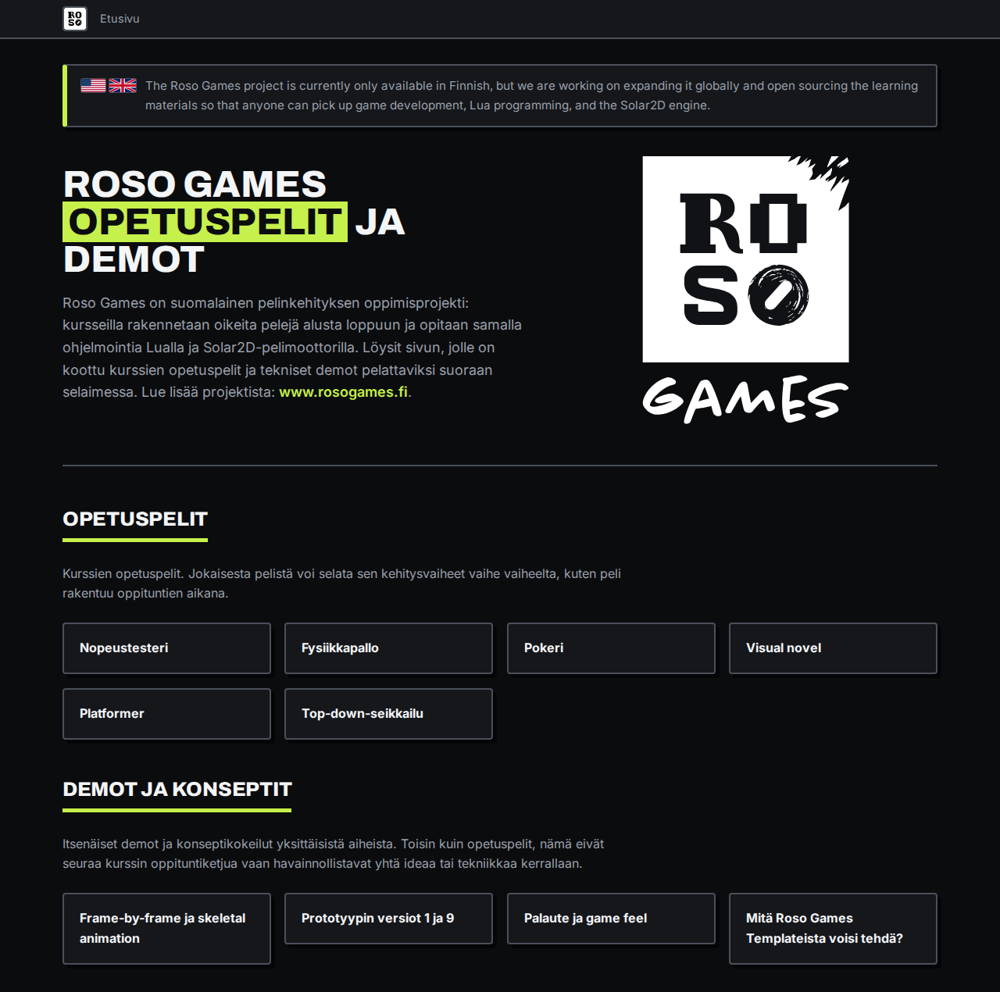

# Roso Games -oppimateriaalit

Tämä repositorio on osa Roso Games -projekteja. Se täydentää osoitteessa [www.rosogames.fi/opetus](https://www.rosogames.fi/opetus) olevaa oppimisympäristöä: täältä löydät kurssien kotitehtävät vastauksineen sekä opetuspelien lähdekoodit kehitysvaiheittain.

Sisältö on toistaiseksi vain suomeksi. Englanninkielinen laajennus on mahdollinen myöhemmin.

## Selaimessa pelattavat versiot

Kaikki opetuspelit ja demot ovat pelattavissa selaimessa [oppimateriaalien verkkosivustolla](https://rosotuotanto.github.io/RG-Learning-Materials/). Sieltä löytyy jokaisen opetuspelin jokainen kehitysvaihe: version sivulta näet, mihin oppituntiin versio kuuluu, ja pääset sen lähdekoodiin ja muutoksiin edelliseen versioon verrattuna.

## Rakenne

- [`homework/`](homework/README.md): kurssien 2-6 kotitehtävät ja niiden vastaukset sekä kurssin 2 oppituntien pienten harjoitusten vastaukset.
- [`solar2d-projects/games/`](solar2d-projects/games/README.md): opetuspelit. Jokainen `versio-N`-kansio on kokonainen projekti, jonka voit avata Solar2D Simulatorissa siinä tilassa, jossa peli on oppitunnin lopussa. `versio-kotitehtavat` sisältää kurssin ohjelmointikotitehtävien malliratkaisun.
- `solar2d-projects/demos/`: demojen lähdekoodit.
- [`solar2d-projects/assignments/`](solar2d-projects/assignments/README.md): tehtäväpohjat eli lähes valmiit Solar2D-projektit, joita täydennetään oppituntien tehtävissä.

## Kotitehtävät ja vastaukset

Kotitehtävät ovat vapaaehtoisia ja ne tehdään itsenäisesti omalla ajalla. Niitä ei käydä läpi viikkotapaamisissa, vaan vastaukset ovat täällä avoimesti itseopiskelua ja oman työn tarkistamista varten. Tee tehtävä ensin itse ja vertaa vasta sitten omaa ratkaisuasi vastaukseen: niin opit eniten.

Sisältö täydentyy vaiheittain. Puuttuva mallivastaus tai pelin kehitysvaihe ei ole virhe, vaan se lisätään myöhemmin.

## Muut Roso Games -materiaalit

- [RG-Game-Templates](https://github.com/RosoTuotanto/RG-Game-Templates): Roso Games Templatejen lähdekoodit. Jokaisen ryhmän peli tehdään jonkin näistä templateista pohjalle.
- [RG-Project-Template](https://github.com/RosoTuotanto/RG-Project-Template): pohja, josta jokaisen ryhmän GitHub-repositorio luodaan.

## Tekijä

[© 2025-2026 Eetu Rantanen](https://www.erantanen.com)

Oppimateriaalit on tehty Roso-tuotannon Roso Games -projekteja varten.

## Lisenssi

[MIT](LICENSE)

Roso Gamesia varten kirjoitetun koodin tekijänoikeudet kuuluvat Eetu Rantaselle ja Roso Gamesille (Kukunori ry). Muualta tulevat kirjastot, fontit, grafiikat ja äänet sekä niiden lisenssit on lueteltu [NOTICE.md](NOTICE.md)-tiedostossa. Roso Games -ryhmien omat peliprojektit ja niiden koodi eivät ole MIT-lisensoituja: ne kuuluvat ryhmille ja ovat vain ryhmien omassa käytössä.
